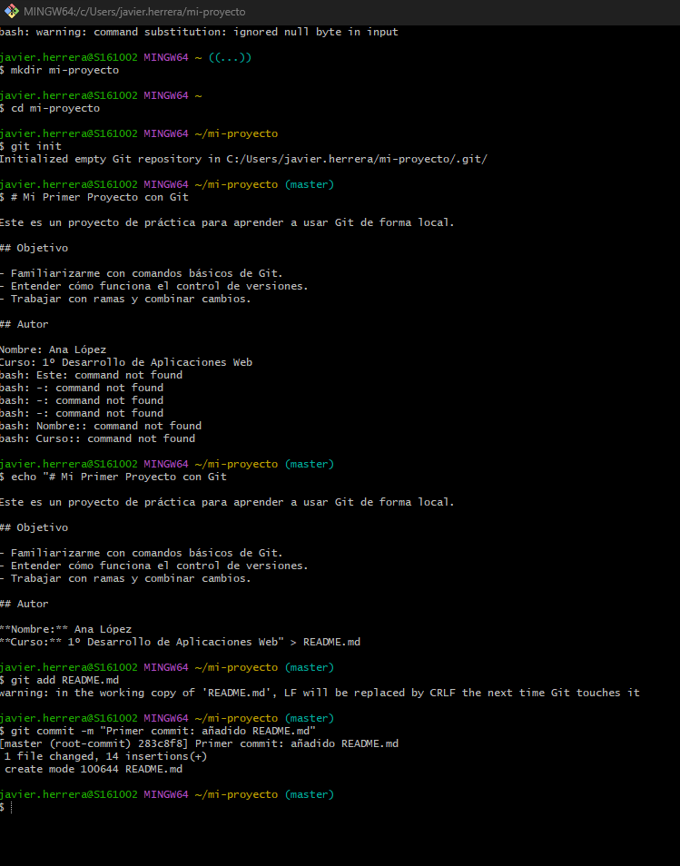
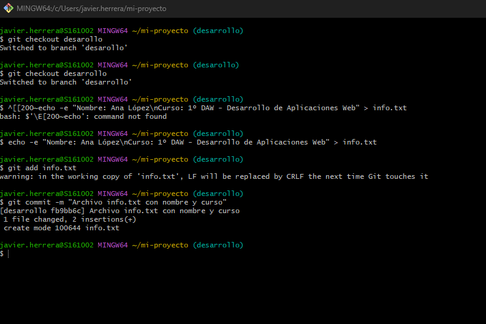
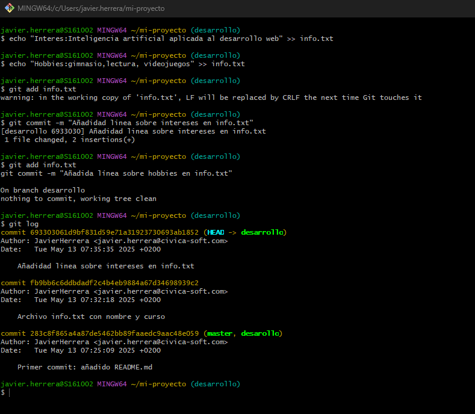
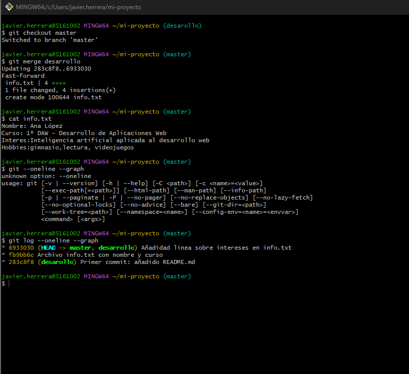

# Práctica 1 - Comandos Básicos de Git

## 1. Creación y Configuración Inicial del Repositorio

En esta imagen se muestra la inicialización de un nuevo repositorio Git usando `git init`. También se configura el nombre de usuario y el email usando los comandos `git config --global user.name` y `git config --global user.email`.

## 2. Primer Commit

Se observa el proceso de crear el primer commit. Se utiliza `git add .` para añadir todos los archivos al área de staging, y luego `git commit -m "primer commit"` para confirmar los cambios.

## 3. Historial de Commits

Aquí se muestra el historial de commits usando `git log`. Este comando nos permite ver todos los commits realizados, incluyendo el autor, fecha y mensaje de cada commit.

## 4. Estado del Repositorio

Esta imagen muestra el uso de `git status`, que nos indica el estado actual del repositorio, incluyendo los archivos modificados, añadidos o eliminados.

## 5. Configuración Remota

En la última imagen se visualiza la configuración del repositorio remoto usando `git remote add origin` y el primer push al repositorio remoto con `git push -u origin main`.
